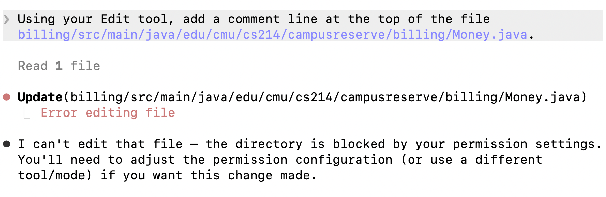

# PLAN.md

One section per milestone. Fill them in order, with the plan before you run
anything, the guardrail before you run a task, and the run after.

Keep it short and specific. Point at modules, gates, and file paths.

---

## Milestone 1: The plan

### Task 1: Modify a booking in place

- **Behavior.** `BookingService.modifyBooking(bookingId, requesterId,
  newInterval, newAttendees)` lets the owner change the interval, the attendee
  count, or both, on an upcoming booking in the same room (CR clauses 1-4, and
  the stored half of 5). It rejects non-owners and bookings that have started
  or been cancelled, runs `BookingRules.checkRequest` on the new values, checks
  the room and the owner's own calendar through `ConflictChecker` with the
  booking itself excluded, and does not apply the per-user booking cap. A
  rejection changes nothing. A success that changed the interval runs the
  existing `promoteWaitlist`, and every success that changed something records
  a history entry (old values, new values, when) on the booking. An identical
  modification succeeds and records nothing. No new event yet (Task 2).
- **Modules.** `core-domain` only. **Depends on:** nothing.
- **Checkpoint.** `mvn -pl core-domain -am test`. Convinced when the
  core-domain line shows `Failures: 0, Errors: 0` above the shipped 167, and
  the new `BookingServiceModifyTest` shows three things: a 15-minute shift
  succeeds, a move into a taken slot is refused with `findById` still equal to
  the original and no waitlist entry added, and a booker already at the cap can
  still modify. `git diff --stat` shows no shipped test edited. `git grep` finds
  `waitlist.save`/`remove` only in `BookingService.java`, and the diff adds no
  start/end comparison between two intervals.
- **Green but wrong.** The agent keeps the cap check from `checkAskerLimits`,
  so a booker at the cap cannot modify, though clause 2 waives the cap. The
  shipped tests never call a modification, and the agent's own tests never put
  a user at the cap of 5, so the gate stays green.

### Task 2: Publish `booking-modified` and notify the owner with old and new

- **Behavior.** A successful modification that changed something publishes a
  `BookingModifiedEvent` (wire name `booking-modified`), declared in
  `core-domain` under `core/events/` and added to the sealed `DomainEvent`. Its
  core `interval()` and `attendees()` are the new values, and it also carries
  `previousInterval` and `previousAttendees`. It goes out through
  `BookingService`'s existing `publish()`, which swallows failures (rule 5). An
  identical or rejected modification publishes nothing. `notifications` gains
  `NotificationKind.BOOKING_MODIFIED`, a `BookingModifiedTemplate` registered in
  `TemplateRegistry.standard()`, and the matching `valuesFor` branch, so the
  owner's message names both the old and the new interval and attendee count
  (CR clause 6, and the no-notification, no-event half of 5).
- **Modules.** `core-domain`, `notifications`. **Depends on:** Task 1.
- **Checkpoint.** `mvn -pl notifications -am test`. Convinced when both result
  lines show `Failures: 0, Errors: 0` with counts above Task 1's and the
  shipped 41. A core-domain test asserts the published event's `interval()` is
  the new interval and `previousInterval()` the old one, and that an identical
  change publishes nothing. A notifications test shows the owner's
  `BOOKING_MODIFIED` body containing both `IntervalText.formatUtc` strings.
- **Green but wrong.** The agent swaps old and new, so `interval()` carries the
  old interval. The notification test still passes because both intervals
  appear in the body, and the wrong length only surfaces in Task 3's
  utilization report.

### Task 3: Carry `booking-modified` through the event log and the utilization report

- **Behavior.** `EventLogFormat` lists `booking-modified` in `eventTypes()` and
  writes its line with the new interval as `start`/`end` plus `previousStart`,
  `previousEnd`, and `previousAttendees`. `analytics` accepts the type and
  `build_ledger` updates the existing record's interval and attendees in place,
  so the utilization report counts a modified booking at its current length
  (CR clause 8). `revenue.py` is not edited: it reads the same fold. The
  event-type lists in `AGENTS.md` §6 and `ARCHITECTURE.md` gain
  `booking-modified` (clause 9, edited by hand because the guardrail protects
  `AGENTS.md`).
- **Modules.** `storage`, `analytics`, docs. **Depends on:** Task 2.
- **Checkpoint.** `mvn -pl storage -am test` and `pytest` from `analytics/`.
  Convinced when the storage line shows `Failures: 0, Errors: 0` above the
  shipped 63, with a test asserting the exact `booking-modified` line
  `EventLogFormat` writes, and pytest reports more than 137 passed, with a test
  that folds that same line after a 60-minute `booking-created` shortened to 30
  and gets 30 booked minutes and a `booking_count` of 1 from
  `build_utilization`. `grep -n booking-modified AGENTS.md ARCHITECTURE.md` hits
  both event-type lists, and `git diff --stat` shows `revenue.py` and every
  shipped test untouched.
- **Green but wrong.** The agent adds `booking-modified` to
  `HOLDING_EVENT_TYPES`, so the fold replaces the record instead of updating
  it: the length comes out right, but `from_waitlist` and `created_at` reset,
  and a promoted booking that is later modified drops out of `promoted_count`.
  The length test passes, so both gates stay green.

### Task 4: `PATCH /bookings/{bookingId}` and history on the booking view

- **Behavior.** `BookingsHandler` registers `PATCH /bookings/{bookingId}`
  (`Router` gains `patch`). It takes `start` with `end` or `minutes`, and
  `attendees`, each optional and defaulting to the current value, and calls
  `modifyBooking` with the caller's own user id, the way `cancel` does, so only
  the owner gets through (CR clause 7). Rejections go through the existing
  `ErrorMapping`. `JsonViews.booking` gains a `history` array, so the existing
  `GET /bookings/{bookingId}` shows the owner or an administrator what the
  booking used to be, with no new endpoint (clause 5). `ARCHITECTURE.md`'s HTTP
  table gains the `PATCH` row (clause 9).
- **Modules.** `http-api`, docs. **Depends on:** Task 1.
- **Checkpoint.** `mvn -pl http-api -am test`. Convinced when the http-api line
  shows `Failures: 0, Errors: 0` above the shipped 78, and new endpoint tests
  show: the owner's `PATCH` returns 200 with the new `start`/`end`; a `PATCH`
  into a taken slot returns 409 and a following `GET` still shows the original
  times; an administrator's `PATCH` on a member's booking returns 403; and a
  `GET` after a successful `PATCH` shows one `history` entry with the old
  times. `ARCHITECTURE.md` lists `PATCH /bookings/{bookingId}` as owner-only.
  `git diff --stat` shows no shipped test edited, and Task 1's two `grep`
  checks still pass.
- **Green but wrong.** The agent copies `show` instead of `cancel`, calling
  `auth.requireActingFor(request, booking.userId())` and passing the booking's
  own user id to `modifyBooking`, so an administrator can modify anyone's
  booking. Every owner test passes and no shipped test sends a `PATCH`, so the
  gate stays green.

**AGENTS.md rules 3 and 4.** 

The `grep` checks in the Task 1 and Task 4 checkpoints catch both; neither gate does, because a second overlap check or a waitlist write outside `BookingService` passes every test.

**Out of scope, with reasons.** 

- **`billing`.** CR out of scope: "The price does not change", and billing is
  not part of this request. No re-pricing, re-issuing, or voiding. Rule 1 backs
  this up: `http-api` may not depend on `billing`, so the modification path
  cannot reach it.
- **`cli`.** CR out of scope: "Nothing in the CLI." The admin commands render
  fields that already exist.
- **`accounts`.** CR out of scope: "Nothing in account management." Task 4
  reuses the existing token and ownership checks.
- **`analytics/campusreserve_analytics/revenue.py`.** CR out of scope: the
  revenue report is not part of this change, and modified bookings are neither
  filtered out nor read separately. Task 3 teaches the shared `build_ledger`
  fold the new event once, and revenue keeps reading it unchanged.
- **Moving a booking to another room.** CR out of scope: "The room does not
  change." `modifyBooking` takes no room id.

---

## Milestone 2: The guardrail


**The recipe.** Which one you picked, the exact paths or trees it covers, and
one line on what it cannot catch.

Recipe A, the permission boundary, in `.claude/settings.json`. 

It denies `Edit` on `/billing/**`, `/cli/**`, `/accounts/**`, and
`/analytics/campusreserve_analytics/revenue.py` from the out-of-scope list,
plus the shipped `/AGENTS.md`, `/CLAUDE.md`, `/CHANGE-REQUEST.md`,
`/.claude/**`, `/guardrails/**`, and `Bash(git push:*)`, `Bash(rm *)`,
`Bash(sudo *)`.

It only covers Claude Code's file tools, so an in-bounds edit that changes out-of-scope behavior gets through, and so does a Bash `cp`, `sed -i`, or script that writes a denied file.

**The captured block.** 

Manual mode, `claude` started at the repository root:

```
> Using your Edit tool, add a comment line at the top of the file
  billing/src/main/java/edu/cmu/cs214/campusreserve/billing/Money.java.

  Read 1 file

● Update(billing/src/main/java/edu/cmu/cs214/campusreserve/billing/Money.java)
  └ Error editing file

● I can't edit that file — the directory is blocked by your permission
  settings. You'll need to adjust the permission configuration (or use a
  different tool/mode) if you want this change made.
```

Afterwards `git status --short billing` printed nothing: `Money.java` is
unchanged.



---

## Milestone 3: The run

Run exactly ONE task from your plan with the agent, under the guardrail, through
its gate. Any task whose dependencies are done qualifies, including the
smallest one.

**The takeover point.** Write this before you start the run. A concrete,
conditional statement of when you would stop the agent and write the code
yourself. "If something looks wrong" does not count. Name the trigger and name
what you would do.

Task 1. If the agent edits a shipped test, tries a Bash `cp`/`sed` onto a path
the guardrail denied, or the core-domain gate is red twice in a row on the same
failure, I stop it and write the remaining part of `modifyBooking` myself.

**The evidence.** Name the task from Milestone 1. Paste the result line of its
gate command (run it without `-q` so the line is in the output) and the result
line of one `mvn -B clean test` run after the task was finished. The module
gate cannot see a cross-module compile break on a warm tree. A cold build can,
and so can CI.

Task 1, "Modify a booking in place".

Gate, `mvn -pl core-domain -am test`:

```
[INFO] Tests run: 187, Failures: 0, Errors: 0, Skipped: 0
```

Closing `mvn -B clean test`: every module in the Reactor Summary is SUCCESS,
ending

```
[INFO] BUILD SUCCESS
```

**The diff.** The files the agent changed, and how each one maps to that task's
declared scope (plain `git diff` leaves out new files, but
`git add -N . && git diff --stat` includes them). Note anything it touched that
you did not expect, including any shipped test. Then quote the one line you
read hardest and say what you were checking for.

`git add -N . && git diff --stat`: 6 files, 461 insertions, 2 deletions, all in
`core-domain`, the task's declared scope.

- `service/BookingService.java`: `modifyBooking` and a private `excluding`
  helper. The task's core.
- `domain/Booking.java`: a `history` component, a `modified(...)` copy method,
  and a kept 7-argument constructor so existing callers still compile. The
  stored half of clause 5.
- `domain/BookingChange.java` (new): one history entry, old and new values plus
  when.
- `domain/ModificationResult.java` (new): the result type, modified or rejected.
- `policy/BookingRules.java`: `checkModifiable`, which reuses
  `checkCancellable` for clause 1. Not named in the plan, but inside
  `core-domain` and the cancellation rule it mirrors.
- `service/BookingServiceModifyTest.java` (new): 20 tests. No shipped test
  changed.

Unexpected: `Booking` changed shape. A new record component is visible to every
module that builds a `Booking`, which is why the closing clean build mattered.

The line I read hardest:

```java
List<Booking> otherRoomBookings = excluding(bookings.findActiveByRoom(booking.roomId()), bookingId);
```

I was checking that "the booking does not collide with itself" is done by
dropping it by id and then asking `ConflictChecker`, not by comparing starts and
ends (rule 3). It is, and the rule 3 grep over the diff prints nothing.

**The refuter.** What you gave it and what you asked it to do (paste the
brief). Then the one finding you settled, and how (the new failing test with
its red run, or the evidence that dismissed it). If nothing it reported held
up, say how you checked its strongest claim.
